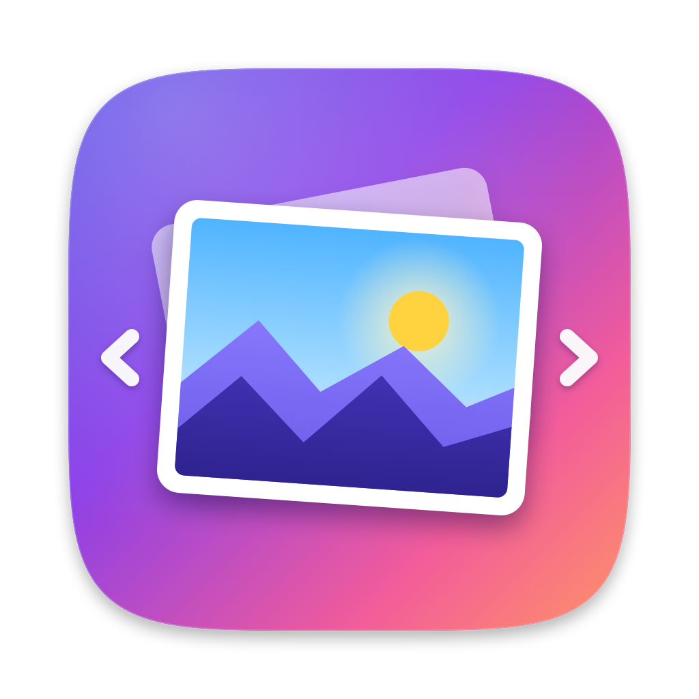
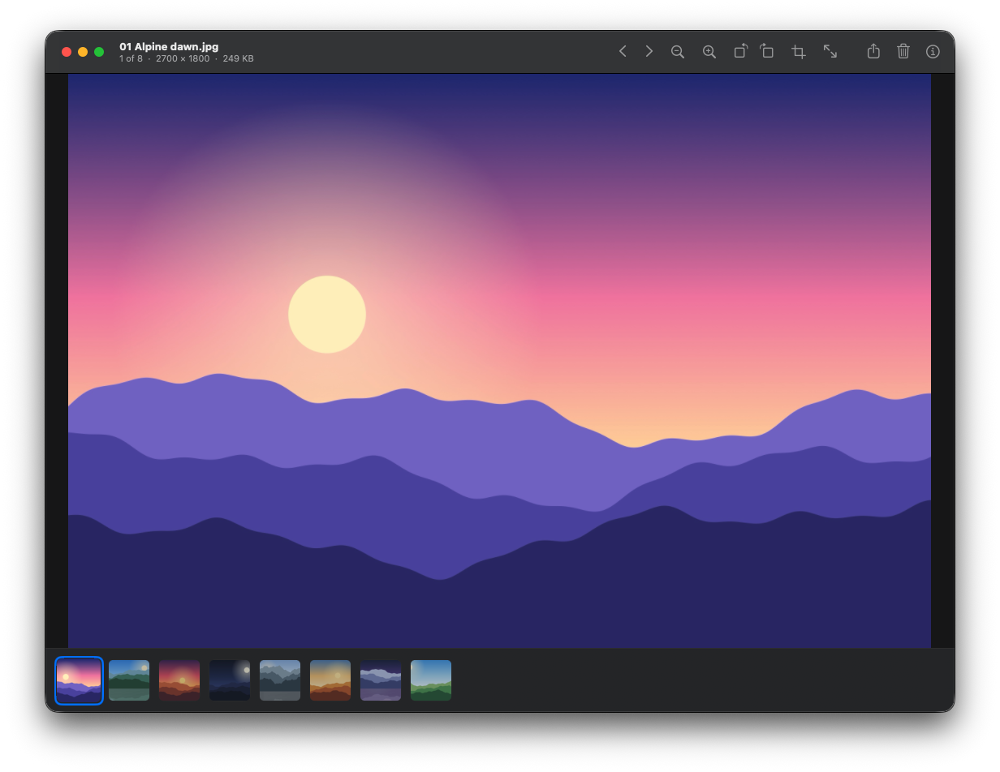
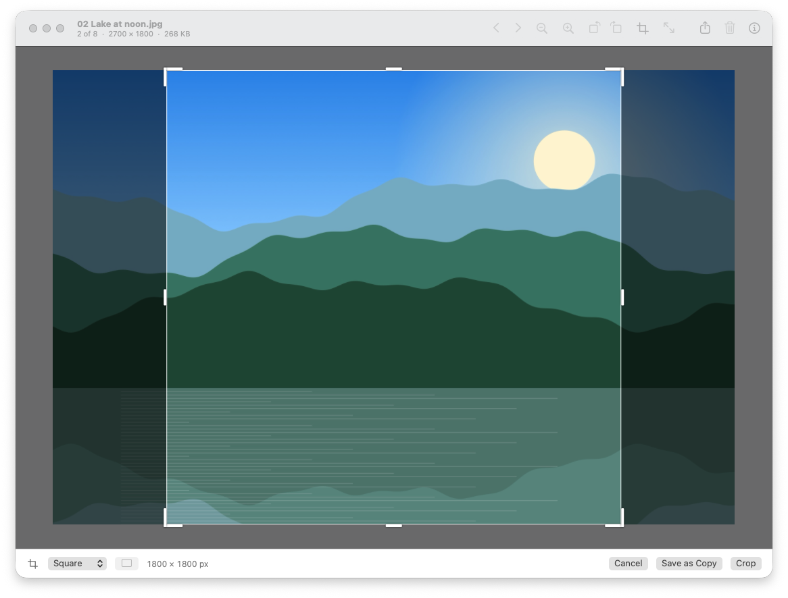
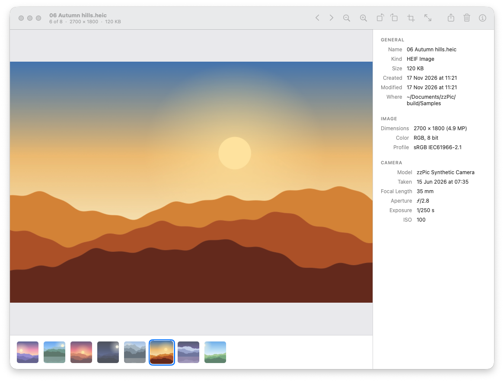

<p align="center">
  
</p>

<h1 align="center">zzPic</h1>

<p align="center">
  <b>Open a picture, then flip through every image in its folder with ← →.</b><br>
  A fast, minimal image viewer for macOS — the one thing Preview doesn't do.
</p>

<p align="center">
  
  
  
  <a href="LICENSE"></a>
</p>

<p align="center">
  
</p>

---

On Windows you double-click a photo and simply press the arrow keys to see the next one.
On the Mac, Preview opens just the file you clicked. **zzPic** brings back the simple way:
open any image and the whole folder is ready to browse — with a few quick edits for the
everyday jobs, and **Preview one shortcut away** (`⌘E`) for everything else.

## Features

- **Browse the folder** — `←` `→` (or a two-finger swipe, or the mouse wheel), `Home` / `End`, with a thumbnail filmstrip at the bottom. Neighbouring images are decoded in advance, so flipping is instant.
- **Zoom & pan** — pinch, `⌘+` / `⌘−`, double-click to toggle *Fit* ⇄ *100 %*, drag to pan.
- **Rotate** — `⌘L` / `⌘R`. For JPEG, HEIC and TIFF it's **lossless**: only the orientation flag changes, the pixels are never re-compressed.
- **Crop** — `⌘K`, with Freeform, Original, Square, 4:3, 3:2 and 16:9 ratios (portrait or landscape) and a rule-of-thirds grid.
- **Resize** — `⇧⌘R`, by pixels, percentage or longest side, keeping proportions.
- **Save or Save as Copy** — every edit can overwrite the file or create `name copy.jpg` next to it. Format and metadata (EXIF, GPS, colour profile) are preserved.
- **Duplicate** (`⌘D`), **Move to Trash** (`⌘⌫` or just `⌫`), **Copy** (`⌘C`), **Print** (`⌘P`), **Share**, **Show in Finder** (`⌥⌘R`).
- **Undo everything** — `⌘Z` restores overwritten files, brings trashed photos back and removes copies. Redo works too.
- **Info panel** (`⌘I`) — dimensions, file details, camera, lens, exposure, and location with a link to Maps.
- **Edit in Preview** (`⌘E`) for markup, colour adjustments and everything else. zzPic notices when the file changes and reloads it.
- Animated GIFs, HEIC, RAW, WebP, PNG, TIFF… anything macOS can read. Drag a photo out of the window to Finder or Mail, drop files or folders in.
- Native AppKit + SwiftUI, light & dark mode, **English and Italian**. No tracking, no network access, no dependencies.

<p align="center">
  
  
</p>

## Install

### Download

1. Grab `zzPic-x.y.z.zip` from the [**Releases**](https://github.com/lucalazzaroni/zzPic/releases) page and unzip it.
2. Move **zzPic.app** to your *Applications* folder.
3. The app is open-source and not notarized by Apple, so the first time **right-click it → Open → Open**
   (or run `xattr -dr com.apple.quarantine /Applications/zzPic.app`).

### Build from source

Requires macOS 14 or later and Xcode (the free Command Line Tools alone lack SwiftUI's macros).

```bash
git clone https://github.com/lucalazzaroni/zzPic.git
cd zzPic
make install   # builds a universal app and copies it to /Applications
```

Other targets: `make run`, `make test`, `make zip`, `make icon`.

### Make zzPic your default image viewer

In Finder, select any `.jpg` → **File ▸ Get Info** (`⌘I`) → **Open with:** *zzPic* → **Change All…**
Repeat for the other formats you use (`.png`, `.heic`, …).

## Keyboard shortcuts

| Action | Keys | | Action | Keys |
|---|---|---|---|---|
| Next / previous image | `→` `←` | | Rotate left / right | `⌘L` `⌘R` |
| First / last image | `Home` `End` | | Crop | `⌘K` |
| Zoom in / out | `⌘+` `⌘−` | | Resize | `⇧⌘R` |
| Actual size / fit | `⌘0` `⌘9` | | Undo / redo | `⌘Z` `⇧⌘Z` |
| Toggle fit ⇄ 100 % | double-click | | Duplicate | `⌘D` |
| Filmstrip | `⌘T` | | Move to Trash | `⌫` `⌘⌫` |
| Info panel | `⌘I` | | Edit in Preview | `⌘E` |
| Full screen | `⌃⌘F` | | Show in Finder | `⌥⌘R` |
| Open | `⌘O` | | Print | `⌘P` |

While cropping: `↩` crops, `Esc` cancels.

## How edits are saved

- Edits are written to a hidden temporary file in the same folder and then swapped in atomically, so a crash can never leave a half-written photo.
- Before a file is overwritten, the original is stashed in `~/Library/Caches/io.github.lucalazzaroni.zzPic/UndoBackups` for **Undo**. The stash is cleared at the next launch.
- Formats macOS can read but not write (e.g. camera RAW) can still be cropped or resized with **Save as Copy**, which produces a JPEG.

## Project layout

```
Sources/
  ZZPicKit/   folder scanning, decoding & caching, lossless rotation, crop/resize, metadata  (unit-tested)
  zzPic/      the app: AppKit window, toolbar & menus, zoomable canvas, crop overlay, SwiftUI panels
Resources/    Info.plist, app icon, en/it localizations
Scripts/      build-app.sh (bundle + ad-hoc signing), make-icon.swift (draws the icon in code)
Tests/        Swift Testing suite
```

The icon is drawn entirely in code by [`Scripts/make-icon.swift`](Scripts/make-icon.swift).

## Contributing

Issues and pull requests are welcome. Please run `make test` before opening a PR.
New UI strings go through `L("…")` and need an entry in `Resources/it.lproj/Localizable.strings`.

## License

[MIT](LICENSE) © 2026 Luca Lazzaroni

---

<details>
<summary>🇮🇹 <b>In italiano</b></summary>

**zzPic** è un visualizzatore di immagini per macOS pensato per una cosa sola: apri una foto e
scorri tutte le altre della stessa cartella con le frecce, come su Windows. Include le modifiche
di tutti i giorni — ruota (senza perdita di qualità per JPEG/HEIC), ritaglia, ridimensiona,
duplica, sposta nel Cestino, stampa — tutte annullabili con `⌘Z`. Per il resto c'è
**Modifica in Anteprima** (`⌘E`). L'interfaccia è in italiano se il Mac è in italiano.

Installazione: scarica lo zip dalla pagina [Releases](https://github.com/lucalazzaroni/zzPic/releases),
sposta l'app in *Applicazioni* e la prima volta aprila con **clic destro → Apri**.
Per renderla l'app predefinita: seleziona una foto nel Finder → **Archivio ▸ Ottieni informazioni** →
**Apri con:** *zzPic* → **Modifica tutto…**
</details>
